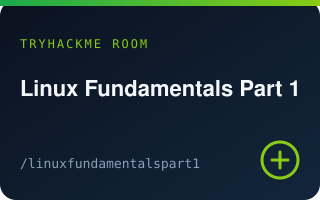
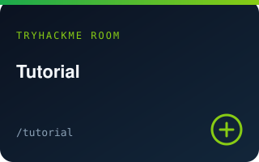
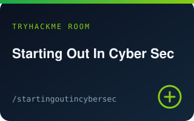
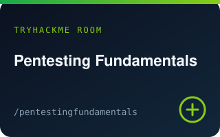

# Ernest Raday

_James Madison University_

 

---

## About

Cybersecurity-focused student at James Madison University. I break things to understand them, then write tools that make the next round faster. This README is my live resume — TryHackMe stats refresh automatically.

---

## Resume

### Experience

**Student · Cybersecurity** — James Madison University · _Present_
  - Coursework spanning systems, networks, and offensive security fundamentals
  - Hands-on practice through TryHackMe rooms, CTF-style challenges, and personal tooling

### Projects

- **[ClickShield](https://github.com/ejrad/ClickShield)** — Browser extension that strips stubborn ad overlays other blockers miss.
- **[deslop](https://github.com/ejrad/deslop)** — Cuts AI-slop noise out of sites like LinkedIn so the feed stays useful.
- **[roblox-util](https://github.com/ejrad/roblox-util)** — Reusable Luau utilities for Roblox games.

### Skills

- **Security:** TryHackMe · Linux · Networking · Web basics · CTF practice
- **Languages:** Python · JavaScript/TypeScript · Luau · Bash
- **Tools:** Git · GitHub Actions · Linux CLI · Browser tooling

### Education

- **James Madison University** — Cybersecurity coursework · _Present_

---

## TryHackMe

   [![Level — [0x6]](https://better-markdown-theta.vercel.app/api/widget?type=card&title=Level&subtitle=%5B0x6%5D&width=180&height=64&radius=12&borderWidth=1&borderColor=%2321262d&align=left&bg=%230d1117&fg=%23ffa657)](https://tryhackme.com)

Using cached / demo TryHackMe data · set `config/profile.json` → `tryhackme` and re-run `npm run update`

### Current streak

Keep the fire going — the streak widget above refreshes on the GitHub Actions schedule.

### Recently completed rooms

| Room | Details |
| :---: | --- |
|  | **[Introductory Networking](https://tryhackme.com/room/introtonetworking)** `introtonetworking` Oct 10, 2026 |
|  | **[Linux Fundamentals Part 1](https://tryhackme.com/room/linuxfundamentalspart1)** `linuxfundamentalspart1` Oct 9, 2026 |
|  | **[How Websites Work](https://tryhackme.com/room/howwebsiteswork)** `howwebsiteswork` Oct 8, 2026 |
|  | **[Tutorial](https://tryhackme.com/room/tutorial)** `tutorial` Oct 7, 2026 |
|  | **[Starting Out In Cyber Sec](https://tryhackme.com/room/startingoutincybersec)** `startingoutincybersec` Oct 6, 2026 |
|  | **[Pentesting Fundamentals](https://tryhackme.com/room/pentestingfundamentals)** `pentestingfundamentals` Oct 5, 2026 |

---

Auto-updated by `scripts/update.mjs` · edit content in `config/profile.json`

